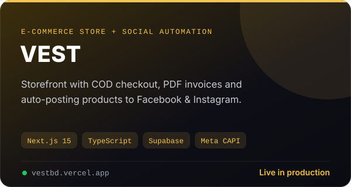

<p align="center">
  
</p>

<p align="center">
  <a href="https://vestbd.vercel.app"></a>
  
  
  
</p>

# VEST

**VEST** is the official online store for the VEST clothing brand in Bangladesh. It covers the full journey — browsing, cash-on-delivery checkout, order tracking and PDF invoices — and comes with an admin dashboard that also **publishes new products to Facebook and Instagram automatically**.

## ✨ Features

**Storefront**
- Product catalogue, collections, search and wishlist
- Swipeable product image galleries and a fully responsive layout (phones → desktop)
- Cash-on-delivery checkout with order rate limiting
- Order tracking with professional order codes (`VST-100xxx`) and downloadable **PDF invoices**
- WhatsApp chat button, store policies and SEO-friendly pages

**Admin dashboard**
- Products, variants, images, collections, coupons and customers
- Order management including DTF print production
- Team members with roles, and a full website settings CMS
- New-order email notifications

**Marketing & automation**
- **Auto-post to Facebook & Instagram** when a product is published, with auto-generated captions, hashtags and product descriptions
- Meta Pixel + **Conversions API**, GA4, GTM and TikTok Pixel tracking
- Product feed (`/feeds/products.xml`) for Meta catalogue ads

## 🛠️ Tech stack

| Layer | Technology |
| --- | --- |
| Framework | Next.js 15 (App Router), React 19 |
| Language | TypeScript |
| Database & auth | Supabase (PostgreSQL) |
| Styling | Tailwind CSS v4 |
| PDFs | jsPDF + html2canvas |
| Integrations | Meta Graph API, Meta CAPI, Resend (email) |
| Hosting | Vercel |

## 🚀 Getting started

```bash
git clone https://github.com/Borhan-Dipto/VEST.git
cd VEST
npm install
npm run dev
```

Then open <http://localhost:3000>.

### Environment variables

Create a `.env.local` file (never commit it) with:

| Variable | Purpose |
| --- | --- |
| `NEXT_PUBLIC_SUPABASE_URL`, `NEXT_PUBLIC_SUPABASE_ANON_KEY` | Supabase project |
| `NEXT_PUBLIC_SITE_URL` | Public site address, used for links and feeds |
| `META_PAGE_ID`, `META_IG_ID`, `META_PAGE_TOKEN` | Facebook / Instagram auto-posting |
| `META_CAPI_TOKEN` | Meta Conversions API |
| `RESEND_API_KEY`, `NOTIFY_EMAIL`, `NOTIFY_FROM` | Order notification emails |
| `HOOK_SECRET` | Protects internal webhooks |

## 📁 Project structure

```
src/
├── app/            # Routes: storefront, checkout, tracking, invoices, admin, API
├── components/     # UI components
└── lib/            # Supabase client, helpers
public/             # Icons, logo, share images
```

---

<p align="center">Built by <a href="https://github.com/Borhan-Dipto">Borhan Dipto</a></p>
